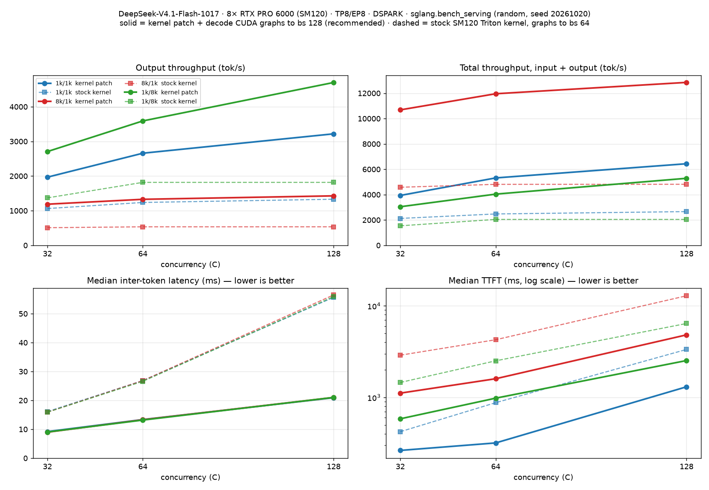
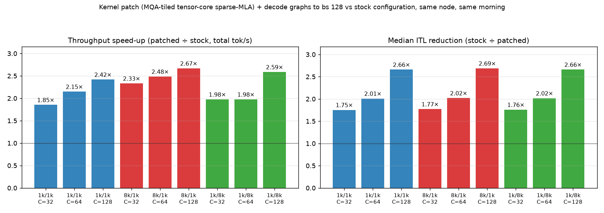
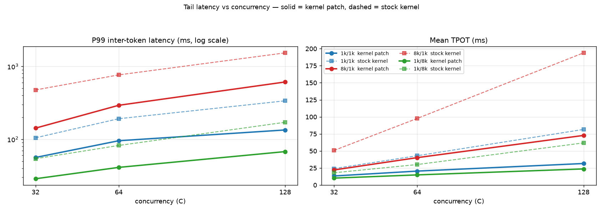

# DeepSeek-V4.1-Flash-1017 on GCP G4 (RTX PRO 6000) — DSPARK + HiCache

Serve [`deepseek-ai/DeepSeek-V4.1-Flash-1017`](https://huggingface.co/deepseek-ai/DeepSeek-V4.1-Flash-1017) with SGLang on a single GKE `g4-standard-384` node (8× NVIDIA RTX PRO 6000 Blackwell Server Edition, SM120, 96 GB VRAM/GPU). This recipe uses **TP8 / EP8**, **FP4 routed experts** (FlashInfer SM120 CUTLASS W4A8 MoE) with **FP8 dense GEMMs and FP8 KV cache**, **DSPARK speculative decoding** (verify window 5), **HiCache** (pinned host-memory KV tier, ratio 2.0) and **Engram host tables**, sized for **262k-token agentic contexts** (AgentX), plus an **SM120 attention-kernel patch** (MQA-tiled tensor-core sparse-MLA decode kernel, applied from a ConfigMap at container start) that roughly doubles throughput.

**Highlights** (single `g4-standard-384` node, 8× RTX PRO 6000 SM120, [`nvfp4-g4-gke-dspark-dsv41-hicach-kernel-ptch.yaml`](./nvfp4-g4-gke-dspark-dsv41-hicach-kernel-ptch.yaml), benchmarked October 20, 2026):
- **4,700 output tok/s** (5,643 tok/s peak) at 1k in / 8k out with 128 concurrent requests; 3,590 tok/s at `C=64` (**5.2–5.3** avg DSPARK accept length out of 5).
- **6,435 total tok/s** (3,218 output tok/s, 5,220 tok/s peak) at 1k in / 1k out with 128 concurrent requests.
- **12,851 total tok/s** (11,423 input tok/s) at 8k in / 1k out with 128 concurrent requests (prefill-bound).
- **9.0–9.2 ms median ITL** at `C=32`, **13.2–13.4 ms** at `C=64` and **21 ms** at `C=128` for every ISL/OSL shape; 10.2 ms mean TPOT at 1k in / 8k out (`C=32`).
- **1.85–2.67× the throughput and ~2× lower latency** of the stock-kernel configuration measured the same morning (see [Benchmark Results](#benchmark-results-october-20-2026)); the full 9-run sweep takes 30 min instead of 3 h 8 m.
- **AgentX** (256k agentic traces, `C=16`, 30 min, stock-kernel config): 295 requests, 0 errors, **742 ms median TTFT**, **26.8 ms median ITL**, ~96k avg input tokens per request with a **94.7 % prompt-cache hit rate**.

| File | Description |
| :--- | :--- |
| [`nvfp4-g4-gke-dspark-dsv41-hicach-kernel-ptch.yaml`](./nvfp4-g4-gke-dspark-dsv41-hicach-kernel-ptch.yaml) | **Recommended.** `PersistentVolumeClaim`, `ConfigMap` (SM120 attention-kernel patch), `Deployment` (patch applied at start, decode CUDA graphs to bs 128), and `Service` — the configuration benchmarked below |
| [`nvfp4-g4-gke-dspark-dsv41-agentx-hicache.yaml`](./nvfp4-g4-gke-dspark-dsv41-agentx-hicache.yaml) | Previous stock-kernel configuration (same flags, no patch, decode CUDA graphs to bs 64) — kept for reference / A-B |
| [`dsv41-flash-bench-sweep-job.yaml`](./dsv41-flash-bench-sweep-job.yaml) | `sglang.bench_serving` ISL/OSL sweep `Job` (1k/1k, 8k/1k, 1k/8k at `C=32/64/128`) |
| [`dsv41-flash-agentx-bench-job.yaml`](./dsv41-flash-agentx-bench-job.yaml) | AgentX (`agentx-harness` / AIPerf agentic replay, 256k traces) `Job` |

---

## Config Details

### Image and Checkpoint

| Component | Value |
| :--- | :--- |
| **Container Image** | `lmsysorg/sglang:dev-dsv41` + the `dsv41-flash-sm120-patch` ConfigMap (a 236-line unified diff for `sglang/kernels/ops/attention/flash_mla_sm120_triton.py`, applied with `patch -d /sgl-workspace/sglang/python -p1 -N -l` before `sglang.launch_server`; no image rebuild) |
| **Model** | [`deepseek-ai/DeepSeek-V4.1-Flash-1017`](https://huggingface.co/deepseek-ai/DeepSeek-V4.1-Flash-1017), downloaded from Hugging Face on first start (~476 GB) into the `dsv41-flash-hf-cache` PVC (600 Gi `dynamic-rwo`, `HF_HOME=/ssd`) |
| **Served Model Name** | `deepseek-ai/DeepSeek-V4.1-Flash-1017` |
| **Target Node / Pool** | `gke-shd-gem-cluster-shd-gem-g4-gpu-po-fce8ea74-n0k0` / `shd-gem-g4-gpu-pool-2` (pinned with `nodeAffinity` + `nodeSelector`) |

- **Hardware**: 8× RTX PRO 6000 Blackwell SE (SM120), 96 GB each, PCIe Gen5 fabric (no NVLink). `NCCL_P2P_LEVEL=SYS` enables direct cross-socket P2P, `NCCL_MIN_NCHANNELS=16` for the TP8 all-reduces, `SGLANG_SET_CPU_AFFINITY=1` pins each TP rank to its 24-core NUMA slice.
- **Quantization**: FP4 routed experts (FlashInfer SM120 CUTLASS W4A8 MoE), FP8 dense weights (`--fp8-gemm-backend flashinfer_cutlass`), FP8 KV cache (`fp8_e4m3`), FP4 sparse-attention indexer (`--enable-deepseek-v4-fp4-indexer`). DeepGEMM is disabled (no SM120 support).
- **Parallelism**: TP8 + EP8 — the FP4 expert intermediate dims need a multiple of 128 per rank.
- **Speculative decoding**: DSPARK with a verify window of 5 (`--speculative-dspark-block-size 5`). CUDA graphs are captured for decode/verify up to batch size 128 (`--cuda-graph-max-bs-decode 128`; with the previous limit of 64, `C=128` decode ran graph-less and ITL doubled — the extra graphs cost ~2.5 GiB, leaving ~20.5 GiB free after capture).
- **SM120 attention-kernel patch**: on SM120 the sparse-MLA attention (`SGLANG_SM120_FLASHMLA_BACKEND=triton`) runs a Triton kernel for both decode *and* prefill (there is no sparse-prefill kernel for this arch), and the stock kernel — one CTA per (token, head), scalar FMAs, each 576-byte KV row gathered once per head — was **54 % of decode and 67 % of prefill GPU time** in a torch-profiler trace. The patched kernel tiles 16 heads per CTA, gathers each KV row once, dequantizes the FP8 × UE8M0 cache exactly to bf16 and runs QKᵀ / PV on tensor cores (`tl.dot`, fp32 accumulation, per-head online softmax). It is 8–11× faster at production shapes and matches the stock kernel to bf16 output rounding (cosine 1.000000 in an oracle test). `SGLANG_SM120_TRITON_MQA=0` restores the stock kernel without a rebuild. The image's default `flashinfer` (CUTLASS) backend cannot be used instead: FlashInfer 0.6.18 rejects this model's TP8 shape (`num_heads=8, topk=128, topk_extra=512`) at warmup.
- **HiCache**: pinned host-memory KV tier behind the GPU radix cache, ratio 2.0, `write_back`, `page_first` layout, `kernel` IO backend, `--enable-cache-report` so clients (and AgentX) see `cached_tokens`.
- **Engram associative memory**: pinned host tables (`SGLANG_ENABLE_DSV41_ENGRAM_HOST_TABLE=1`), layout `private` (one shard per rank + all-reduce; the only layout besides `shared` accepted by this image, and it got 100 % huge pages on COS). ~387 GB of pinned host RAM across the 8 ranks.
- For the model architecture itself (CED decoder, sparse attention, Engram) see the earlier [DeepSeek-V4.1-Flash recipe](../DeepSeekv4.1-Flash/README.md); this directory tracks the `1017` checkpoint with the DSPARK + HiCache agent configuration.

### Server Flags

| Category | Flags |
| :--- | :--- |
| **Model & Quantization** | `--model deepseek-ai/DeepSeek-V4.1-Flash-1017 --trust-remote-code --kv-cache-dtype fp8_e4m3 --fp8-gemm-backend flashinfer_cutlass --enable-deepseek-v4-fp4-indexer` |
| **Parallelism** | `--tp 8 --ep-size 8` |
| **Speculative Decoding** | `--speculative-algorithm DSPARK --speculative-dspark-block-size 5` |
| **Context, KV & Batching** | `--context-length 262144 --mem-fraction-static 0.70 --chunked-prefill-size 8192 --max-prefill-tokens 8192 --max-running-requests 128 --cuda-graph-max-bs-decode 128 --enable-decoder-swa-bounded-replay` |
| **HiCache (Host KV)** | `--enable-hierarchical-cache --hicache-ratio 2.0 --hicache-write-policy write_back --hicache-mem-layout page_first --hicache-io-backend kernel --enable-cache-report` |
| **Parsers & Server** | `--reasoning-parser auto --tool-call-parser auto --watchdog-timeout 3600 --enable-metrics --host 0.0.0.0 --port 30080` |

### Environment Variables

| Variable | Value | Purpose |
| :--- | :--- | :--- |
| `HF_HOME` / `HF_TOKEN` | `/ssd` / secret `hf-token-dsv41` | Weights are fetched from Hugging Face once and cached on the PVC |
| `SGLANG_DEFAULT_THINKING` | `1` | Thinking mode on by default |
| `SGLANG_DSV41_REASONING_EFFORT` | `high` | Reasoning effort for DeepSeek-V4.1 |
| `SGLANG_SM120_FLASHMLA_BACKEND` | `triton` | Triton FlashMLA path on SM120 (no FlashMLA cubins for this arch; the `flashinfer` CUTLASS path rejects the TP8 shape) |
| `SGLANG_SM120_TRITON_MQA` | `1` | Use the patched MQA-tiled sparse-MLA kernel (`0` = stock per-head kernel, no rebuild needed) |
| `SGLANG_FP8_PAGED_MQA_LOGITS_TORCH` | `0` | Use the fused kernel, not the PyTorch fallback, for FP8 paged-MQA indexer logits |
| `SGLANG_ENABLE_DSV41_ENGRAM_HOST_TABLE` / `SGLANG_DSV41_ENGRAM_HOST_TABLE_LAYOUT` | `1` / `private` | Engram tables in pinned host RAM, one shard per rank |
| `SGLANG_TIMEOUT_KEEP_ALIVE` | `1800` | 30-minute HTTP keep-alive for long multi-turn agent tool execution |
| `NCCL_P2P_LEVEL` / `NCCL_P2P_DISABLE` / `NCCL_IB_DISABLE` | `SYS` / `0` / `1` | Direct PCIe P2P across both CPU sockets, no InfiniBand |
| `NCCL_MIN_NCHANNELS` | `16` | Minimum NCCL channels for TP8 all-reduces over PCIe |
| `CUDA_DEVICE_ORDER` / `CUDA_VISIBLE_DEVICES` | `PCI_BUS_ID` / `0,1,2,3,4,5,6,7` | Stable GPU ↔ NUMA mapping |
| `SGLANG_ENABLE_DEEP_GEMM` / `SGLANG_ENABLE_JIT_DEEPGEMM` / `SGLANG_DISABLE_DEEP_GEMM` | `0` / `0` / `1` | DeepGEMM has no SM120 kernels; force the FlashInfer CUTLASS FP8 path |
| `PYTORCH_CUDA_ALLOC_CONF` | `expandable_segments:True` | Reduce allocator fragmentation for 256k-context buffers |
| `SAFETENSORS_FAST_GPU` / `FLASHINFER_DISABLE_VERSION_CHECK` | `1` / `1` | Faster weight load; skip FlashInfer version gate |
| `OMP_NUM_THREADS` / `SGLANG_SET_CPU_AFFINITY` | `24` / `1` | 24 CPU threads per TP rank, pinned to its NUMA slice |

### Memory Sizing for 256k Agent Contexts

The first deployment (`--mem-fraction-static 0.75 --chunked-prefill-size 16384 --max-prefill-tokens 32768`, checkpoint-default 1M context) left only ~13.5 GiB of dynamic GPU memory after CUDA-graph capture and **OOM'd in the DSv4.1 sparse-indexer top-k** (`torch.cat(masks)`, 1.6 GiB) as soon as a 16k-token chunk of a ~256k-token AgentX context was prefilled. The current settings fix that:

- `--context-length 262144` — AgentX max; the checkpoint default is 1M and sizes every context-length buffer 4× larger.
- `--mem-fraction-static 0.70`, `--chunked-prefill-size 8192`, `--max-prefill-tokens 8192`, `--max-running-requests 128`.
- Validated on `shivaji-g4-384-spot` with 1×250k, 4×128k and 8×64k + 1×250k concurrent prompts before redeploying.

### Pod Resources, Probes & Storage

- **Resources**: `cpu: 96`, `memory: 1Ti` request (8 × ~64 GB HiCache host pools + 387 GB Engram + RSS) with **no memory limit** (pinned pages are charged to the pod; a limit OOM-kills at start-up), `nvidia.com/gpu: 8`, 32 Gi `/dev/shm`.
- **Probes**: stock SGLang exposes `/health` (503 while starting, 200 once ready) and **no `/ready`** — a `/ready` startup probe 404s forever and restarts the container every 90 min. `startupProbe` allows 60 min (first-run weight download + load + JIT + CUDA graphs); no `livenessProbe` on purpose (`--watchdog-timeout 3600` is SGLang's own hung-scheduler killer).
- **Storage**: weights on the `dsv41-flash-hf-cache` PVC, reused across pod re-creations (the earlier pod-scoped ephemeral volume re-downloaded 476 GB on every redeploy). Triton/FlashInfer JIT caches live on `hostPath` (`/var/lib/sglang-cache/dsv41-flash`, `/var/lib/flashinfer-cache/dsv41-flash`) so restarts skip recompilation.
- `strategy: Recreate` — a surge pod can never fit next to the running one (8 GPUs, RWO volume).

---

## Deploy & Test on GKE

### 1. Deploy

Create the Hugging Face token secret once, update the `nodeAffinity` hostname / `nodeSelector` pool in [`nvfp4-g4-gke-dspark-dsv41-hicach-kernel-ptch.yaml`](./nvfp4-g4-gke-dspark-dsv41-hicach-kernel-ptch.yaml) to your G4 node, then apply:

```bash
kubectl create secret generic hf-token-dsv41 --from-literal=HF_TOKEN=<token>   # once
kubectl apply -f nvfp4-g4-gke-dspark-dsv41-hicach-kernel-ptch.yaml
kubectl logs -f -l app=deepseek-v41-flash-nvfp4-g4-dspark-agentx-hicache
```

The first start downloads ~476 GB of weights into the PVC and JIT-compiles the SM120 kernels; later restarts reuse the PVC and the `hostPath` JIT caches. The first log line should be `patching file sglang/kernels/ops/attention/flash_mla_sm120_triton.py`; after CUDA-graph capture expect `available_gpu_mem=~20.5 GB`. The stock-kernel manifest ([`nvfp4-g4-gke-dspark-dsv41-agentx-hicache.yaml`](./nvfp4-g4-gke-dspark-dsv41-agentx-hicache.yaml)) deploys the same way.

### 2. Port-Forward

```bash
kubectl port-forward svc/deepseek-v41-flash-nvfp4-dspark-agentx-hicache 30080:30080
```

### 3. Sample `curl` Commands

#### Health & Models Check
```bash
curl -i http://127.0.0.1:30080/health          # 200 once the engine is up (there is no /ready)
curl -s http://127.0.0.1:30080/v1/models | jq .
```

#### Chat Completion (Non-Streaming)
> **Note:** Thinking is on by default (`SGLANG_DEFAULT_THINKING=1`, `--reasoning-parser auto`), so the model emits chain-of-thought in `reasoning_content` before the final `content`. Use `max_tokens >= 1024` so both complete.

```bash
curl -s http://127.0.0.1:30080/v1/chat/completions \
  -H "Content-Type: application/json" \
  -d '{
    "model": "deepseek-ai/DeepSeek-V4.1-Flash-1017",
    "messages": [
      {"role": "user", "content": "Explain speculative decoding in 3 bullet points."}
    ],
    "max_tokens": 1024,
    "temperature": 0.6
  }' | jq .
```

#### Chat Completion (Streaming)
```bash
curl -N http://127.0.0.1:30080/v1/chat/completions \
  -H "Content-Type: application/json" \
  -d '{
    "model": "deepseek-ai/DeepSeek-V4.1-Flash-1017",
    "messages": [
      {"role": "user", "content": "Write a Python script to check GPU compute capability with PyTorch."}
    ],
    "max_tokens": 1024,
    "temperature": 0.6,
    "stream": true
  }'
```

### 4. Run the Benchmarks

Both benchmark Jobs run on the serving node (no GPU requested), talk to the in-cluster Service, and keep their pod alive for 2 h after finishing so results can be copied out.

```bash
# ISL/OSL sweep (sglang.bench_serving, ~30 min with the kernel patch, ~3 h with the stock kernel)
kubectl apply -f dsv41-flash-bench-sweep-job.yaml
kubectl logs -f job/dsv41-flash-bench-sweep
kubectl cp <pod>:/results ./results/sweep && kubectl delete job dsv41-flash-bench-sweep

# AgentX agentic replay (agentx-harness 1.0.7, C=16 and C=32, 30 min each)
kubectl apply -f dsv41-flash-agentx-bench-job.yaml
kubectl logs -f job/dsv41-agentx-bench
kubectl cp <pod>:/results ./results/agentx && kubectl delete job dsv41-agentx-bench
```

The sweep Job's log for the run below is in [`results/results.txt`](./results/results.txt) (it prints every `bench_serving` summary plus a markdown table at the end).

---

## Benchmark Results (October 20, 2026)

### ISL/OSL Sweep — `sglang.bench_serving` (kernel patch + decode graphs to bs 128)

Measured with `python3 -m sglang.bench_serving --backend sglang --dataset-name random --random-range-ratio 1.0 --seed 20261020` (default `temperature 0.0`, 1 warm-up request, `/flush_cache` before every run) from a pod on the same node against the [`nvfp4-g4-gke-dspark-dsv41-hicach-kernel-ptch.yaml`](./nvfp4-g4-gke-dspark-dsv41-hicach-kernel-ptch.yaml) deployment (pod `deepseek-v41-flash-nvfp4-g4-dspark-agentx-hicache-6c8fdb8fxmmf6`). Prompt counts are 3×C for 1k/1k and 8k/1k, and 2×C (min 64) for 1k/8k; the nine runs took 30 minutes end to end (20:29–20:59 UTC). Raw log: [`results/results.txt`](./results/results.txt).



*Solid lines: this recipe (kernel patch + decode CUDA graphs to bs 128). Dashed: the stock-kernel configuration measured the same morning. Top: output and total token throughput; bottom: median inter-token latency and median TTFT (log scale).*



*Per-run speed-up: total throughput (left) and median ITL reduction (right), patched vs stock.*

#### Throughput & Speculative Decoding

| Scenario (ISL / OSL) | C | Completed | Duration (s) | Req/s | Input tok/s | Output tok/s | Total tok/s | Peak Output tok/s | Avg Accept Len |
| :--- | :---: | :---: | :---: | :---: | :---: | :---: | :---: | :---: | :---: |
| **`1k_1k`** (1024 / 1024) | 32 | 96 | 49.97 | 1.92 | 1,967.4 | 1,967.4 | 3,934.8 | 2,953.0 | 4.76 |
| **`1k_1k`** (1024 / 1024) | 64 | 192 | 73.95 | 2.60 | 2,658.6 | 2,658.6 | 5,317.2 | 4,200.0 | 4.78 |
| **`1k_1k`** (1024 / 1024) | 128 | 384 | 122.21 | 3.14 | 3,217.7 | 3,217.7 | 6,435.4 | 5,220.0 | 4.75 |
| **`8k_1k`** (8192 / 1024) | 32 | 96 | 82.80 | 1.16 | 9,497.7 | 1,187.2 | 10,684.9 | 3,305.0 | 5.29 |
| **`8k_1k`** (8192 / 1024) | 64 | 192 | 148.00 | 1.30 | 10,627.3 | 1,328.4 | 11,955.7 | 4,452.0 | 5.21 |
| **`8k_1k`** (8192 / 1024) | 128 | 384 | 275.38 | 1.39 | 11,423.4 | 1,427.9 | 12,851.3 | 5,521.0 | 5.24 |
| **`1k_8k`** (1024 / 8192) | 32 | 64 | 193.75 | 0.33 | 338.3 | 2,706.1 | 3,044.3 | 3,365.0 | 5.29 |
| **`1k_8k`** (1024 / 8192) | 64 | 128 | 292.05 | 0.44 | 448.8 | 3,590.4 | 4,039.2 | 4,577.0 | 5.30 |
| **`1k_8k`** (1024 / 8192) | 128 | 256 | 446.25 | 0.57 | 587.4 | 4,699.5 | 5,286.9 | 5,643.0 | 5.28 |

#### Latency Summary (ms)

| Scenario | C | Median TTFT | P99 TTFT | Mean TPOT | Median TPOT | Median ITL | P99 ITL | Median E2E |
| :--- | :---: | :---: | :---: | :---: | :---: | :---: | :---: | :---: |
| **`1k_1k`** | 32 | 263.6 | 2,685.2 | 13.27 | 12.06 | 9.19 | 56.21 | 12,895.3 |
| **`1k_1k`** | 64 | 318.2 | 4,450.6 | 20.45 | 18.85 | 13.36 | 95.37 | 20,452.5 |
| **`1k_1k`** | 128 | 1,305.0 | 8,740.3 | 31.57 | 29.28 | 20.92 | 134.06 | 32,517.0 |
| **`8k_1k`** | 32 | 1,113.2 | 15,949.7 | 22.14 | 21.97 | 8.98 | 142.10 | 25,169.8 |
| **`8k_1k`** | 64 | 1,599.1 | 31,796.7 | 40.18 | 39.42 | 13.29 | 292.29 | 46,462.0 |
| **`8k_1k`** | 128 | 4,819.9 | 64,011.7 | 72.78 | 71.26 | 21.02 | 610.60 | 86,102.6 |
| **`1k_8k`** | 32 | 583.8 | 2,292.4 | 10.17 | 9.65 | 9.04 | 28.70 | 79,795.5 |
| **`1k_8k`** | 64 | 980.9 | 4,491.2 | 14.87 | 14.17 | 13.18 | 41.09 | 117,654.2 |
| **`1k_8k`** | 128 | 2,526.3 | 17,658.1 | 23.63 | 22.51 | 21.02 | 67.66 | 188,541.9 |

<details>
<summary>Full latency percentiles (Mean / P50 / P90 / P95 / P99, ms)</summary>

| Scenario | C | Metric | Mean | Median (P50) | P90 | P95 | P99 |
| :--- | :---: | :--- | :---: | :---: | :---: | :---: | :---: |
| `1k_1k` | 32 | TTFT | 919.9 | 263.6 | 2,627.4 | 2,684.3 | 2,685.2 |
| `1k_1k` | 32 | TPOT | 13.27 | 12.06 | 17.70 | 18.96 | 23.50 |
| `1k_1k` | 32 | ITL | 13.27 | 9.19 | 27.65 | 28.60 | 56.21 |
| `1k_1k` | 32 | E2E | 14,492.4 | 12,895.3 | 19,529.2 | 21,331.1 | 26,606.0 |
| `1k_1k` | 64 | TTFT | 1,285.6 | 318.2 | 3,907.1 | 4,371.7 | 4,450.6 |
| `1k_1k` | 64 | TPOT | 20.45 | 18.85 | 27.95 | 30.52 | 35.22 |
| `1k_1k` | 64 | ITL | 20.45 | 13.36 | 33.14 | 41.49 | 95.37 |
| `1k_1k` | 64 | E2E | 22,205.3 | 20,452.5 | 30,354.2 | 32,180.8 | 36,294.4 |
| `1k_1k` | 128 | TTFT | 2,616.9 | 1,305.0 | 7,110.1 | 8,169.0 | 8,740.3 |
| `1k_1k` | 128 | TPOT | 31.57 | 29.28 | 42.56 | 48.32 | 58.26 |
| `1k_1k` | 128 | ITL | 31.57 | 20.92 | 62.54 | 77.04 | 134.06 |
| `1k_1k` | 128 | E2E | 34,908.2 | 32,517.0 | 46,136.8 | 53,512.7 | 64,638.8 |
| `8k_1k` | 32 | TTFT | 3,765.3 | 1,113.2 | 12,011.5 | 14,432.7 | 15,949.7 |
| `8k_1k` | 32 | TPOT | 22.14 | 21.97 | 31.67 | 34.78 | 37.45 |
| `8k_1k` | 32 | ITL | 22.14 | 8.98 | 26.67 | 93.42 | 142.10 |
| `8k_1k` | 32 | E2E | 26,413.5 | 25,169.8 | 39,194.3 | 41,638.2 | 44,047.1 |
| `8k_1k` | 64 | TTFT | 6,777.5 | 1,599.1 | 23,020.0 | 27,897.6 | 31,796.7 |
| `8k_1k` | 64 | TPOT | 40.18 | 39.42 | 59.90 | 64.85 | 70.79 |
| `8k_1k` | 64 | ITL | 40.18 | 13.29 | 97.76 | 117.39 | 292.29 |
| `8k_1k` | 64 | E2E | 47,884.7 | 46,462.0 | 71,633.9 | 77,335.2 | 82,597.9 |
| `8k_1k` | 128 | TTFT | 15,024.4 | 4,819.9 | 45,938.2 | 56,188.5 | 64,011.7 |
| `8k_1k` | 128 | TPOT | 72.78 | 71.26 | 111.23 | 120.18 | 135.54 |
| `8k_1k` | 128 | ITL | 72.78 | 21.02 | 126.22 | 212.85 | 610.60 |
| `8k_1k` | 128 | E2E | 89,482.7 | 86,102.6 | 136,089.9 | 146,971.7 | 156,754.3 |
| `1k_8k` | 32 | TTFT | 1,054.2 | 583.8 | 2,275.4 | 2,292.0 | 2,292.4 |
| `1k_8k` | 32 | TPOT | 10.17 | 9.65 | 12.08 | 12.58 | 14.35 |
| `1k_8k` | 32 | ITL | 10.17 | 9.04 | 13.42 | 17.85 | 28.70 |
| `1k_8k` | 32 | E2E | 84,317.8 | 79,795.5 | 100,897.7 | 104,774.7 | 119,841.6 |
| `1k_8k` | 64 | TTFT | 1,710.7 | 980.9 | 4,416.1 | 4,464.6 | 4,491.2 |
| `1k_8k` | 64 | TPOT | 14.87 | 14.17 | 17.26 | 19.34 | 22.81 |
| `1k_8k` | 64 | ITL | 14.87 | 13.18 | 19.61 | 26.33 | 41.09 |
| `1k_8k` | 64 | E2E | 123,496.4 | 117,654.2 | 142,777.4 | 161,132.4 | 188,936.3 |
| `1k_8k` | 128 | TTFT | 3,968.0 | 2,526.3 | 8,063.3 | 8,795.0 | 17,658.1 |
| `1k_8k` | 128 | TPOT | 23.63 | 22.51 | 28.15 | 29.62 | 33.41 |
| `1k_8k` | 128 | ITL | 23.63 | 21.02 | 31.28 | 41.75 | 67.66 |
| `1k_8k` | 128 | E2E | 197,538.1 | 188,541.9 | 233,737.5 | 248,793.5 | 278,230.6 |

</details>

#### Improvement over the stock-kernel configuration

Same benchmark, same seed, same node, run the same morning against [`nvfp4-g4-gke-dspark-dsv41-agentx-hicache.yaml`](./nvfp4-g4-gke-dspark-dsv41-agentx-hicache.yaml) (stock Triton kernel, decode CUDA graphs to bs 64):

| Scenario | C | Output tok/s stock → patched | Total tok/s stock → patched | Median TTFT ms | Mean TPOT ms | Median ITL ms | P99 ITL ms |
| :--- | :---: | :--- | :--- | :---: | :---: | :---: | :---: |
| **`1k_1k`** | 32 | 1,062 → **1,967** (1.85×) | 2,123 → **3,935** | 422 → 264 | 24.1 → 13.3 | 16.1 → **9.2** | 105 → 56 |
| **`1k_1k`** | 64 | 1,237 → **2,659** (2.15×) | 2,475 → **5,317** | 876 → 318 | 43.0 → 20.4 | 26.9 → **13.4** | 191 → 95 |
| **`1k_1k`** | 128 | 1,331 → **3,218** (2.42×) | 2,661 → **6,435** | 3,340 → 1,305 | 81.6 → 31.6 | 55.6 → **20.9** | 337 → 134 |
| **`8k_1k`** | 32 | 509 → **1,187** (2.33×) | 4,581 → **10,685** | 2,890 → 1,113 | 50.8 → 22.1 | 15.9 → **9.0** | 475 → 142 |
| **`8k_1k`** | 64 | 535 → **1,328** (2.48×) | 4,811 → **11,956** | 4,264 → 1,599 | 97.7 → 40.2 | 26.8 → **13.3** | 764 → 292 |
| **`8k_1k`** | 128 | 535 → **1,428** (2.67×) | 4,816 → **12,851** | 12,883 → 4,820 | 193.9 → 72.8 | 56.5 → **21.0** | 1,532 → 611 |
| **`1k_8k`** | 32 | 1,370 → **2,706** (1.98×) | 1,541 → **3,044** | 1,456 → 584 | 18.0 → 10.2 | 15.9 → **9.0** | 54 → 29 |
| **`1k_8k`** | 64 | 1,817 → **3,590** (1.98×) | 2,044 → **4,039** | 2,510 → 981 | 30.1 → 14.9 | 26.6 → **13.2** | 82 → 41 |
| **`1k_8k`** | 128 | 1,817 → **4,700** (2.59×) | 2,044 → **5,287** | 6,415 → 2,526 | 61.8 → 23.6 | 55.9 → **21.0** | 171 → 68 |

#### Observations



*P99 inter-token latency (log scale) and mean TPOT vs concurrency — solid = kernel patch, dashed = stock kernel.*

- **Decode no longer saturates.** With the stock kernel, 1k/8k was flat at ~1.8k output tok/s for `C=64` and `C=128`; it now scales 2.7k → 3.6k → 4.7k tok/s from `C=32` → `C=128`, and 1k/1k reaches 3.2k output / 6.4k total tok/s at `C=128` with CUDA graphs covering the whole batch.
- **Prefill is 2.3–2.7× faster.** 8k/1k tops out at ~11.4k input tok/s (12.9k total) instead of ~4.3k, because the same attention kernel served the 8k prefill chunks; P99 TTFT at `C=128` fell from 172 s to 64 s. Prefill is still the bound for prompt-heavy traffic — keep `C ≤ 64` there if TTFT matters.
- **Latency scales with concurrency, not shape.** Median ITL is ~9 ms at `C=32`, ~13 ms at `C=64` and ~21 ms at `C=128` for all three ISL/OSL mixes; `C=32` gives the best interactive feel, `C=64` the best latency/throughput balance.
- **Speculation is unchanged.** DSPARK accept length stays at 4.75–5.30 (greedy, random-token prompts — treat as an upper bound; AgentX measured 3.3), so the gain is purely kernel/graph time and the model's outputs are the same. Correctness was spot-checked end to end on this pod (arithmetic, executable Python, factual Q&A) after the sweep.
- **The 256k-safe memory settings still hold.** Graph capture leaves ~20.5 GiB free per GPU; the 1×250k / 4×128k / 8×64k+1×250k long-context gate passed on the patched configuration before it was deployed.

### AgentX — Agentic Replay (256k traces)

Run with [`dsv41-flash-agentx-bench-job.yaml`](./dsv41-flash-agentx-bench-job.yaml) against the **stock-kernel** configuration (before the patch): `agentx-harness==1.0.7`, scenario `inferencex-agentx-mvp`, public dataset `semianalysis_cc_traces_weka_062126_256k`, `--max-context-length 262144`, streaming chat completions, `ignore_eos:true`, `--cache-bust first_turn_prefix`, `--system-idle-gap-cap-seconds 10`, `--random-seed 20260707`, 1,800 s profiling per concurrency after a 30-request warm-up.

#### `C=16`

| Aggregate | Value |
| :--- | :--- |
| Benchmark duration | 1,797.7 s |
| Requests completed / errors | **295 / 0** (1 in-flight request cancelled at the 30-min cutoff) |
| Request throughput | 0.16 req/s |
| Output token throughput | 126.6 tok/s (232,859 completion tokens total) |
| Input token throughput | 15,334 tok/s (28.2 M prompt tokens total) |
| Prompt-cache read (server `cached_tokens`) | **94.68 %** (theoretical prefix-cache hit 95.22 %) |
| Effective concurrency (AIPerf) | avg 3.5, max 7 — the replay honors the traces' inter-turn gaps (capped at 10 s) and sessions block on earlier turns |
| DSPARK accept rate / length (server metrics) | 45.8 % / **3.29** mean (p50 3.17, p90 3.92) |

| Per-request metric | avg | p50 | p90 | p99 | max |
| :--- | :---: | :---: | :---: | :---: | :---: |
| **TTFT (ms)** | 1,555.4 | **742.4** | 3,003.8 | 12,342.5 | 15,364.6 |
| **Inter-token latency (ms)** | 29.71 | **26.78** | 40.24 | 96.41 | 110.44 |
| **Request latency (ms)** | 21,952.4 | 10,283.8 | 44,872.2 | 182,051.5 | 375,876.8 |
| **Output tok/s per user** | 39.83 | 37.35 | 58.01 | 79.85 | 234.22 |
| Input sequence length (tokens) | 95,643 | 95,875 | 143,275 | 218,090 | 254,216 |
| Output sequence length (tokens) | 789 | 282 | 1,491 | 6,947 | 15,568 |

> **Note:** these AgentX numbers predate the kernel patch; given the ~2× ITL and prefill improvements above, re-running the replay against the patched deployment is the next step.

---
