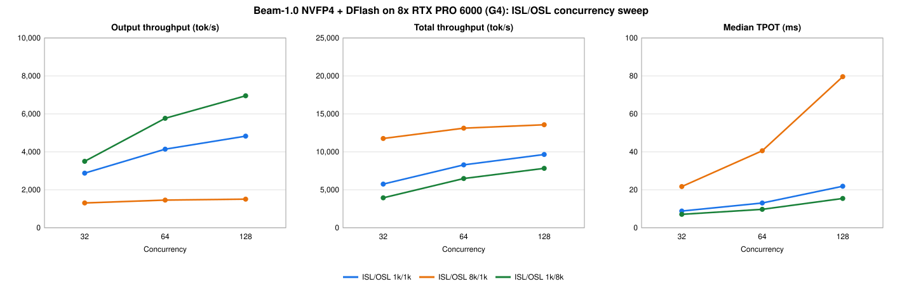

# Reflection Beam-1.0 (NVFP4) on GCP G4 (RTX PRO 6000)

Serve [reflection/Beam-1.0-501B-A23B-NVFP4](https://huggingface.co/reflection/Beam-1.0-501B-A23B-NVFP4) with SGLang on one GKE `g4-standard-384` node (8× NVIDIA RTX PRO 6000 Blackwell, SM120). The setup uses DFlash speculative decoding and HiCache (host-memory KV cache).

**Highlights** (single node, benchmarked October 16, 2026):
- **6,953 output tok/s** at 1k in / 8k out with 128 concurrent requests.
- **13.6K total tok/s** at 8k in / 1k out with 128 concurrent requests.
- **8.8 ms median TPOT** (about 114 tok/s per request) at 1k/1k with 32 concurrent requests.
- **Close to BF16 accuracy**: on the headline benchmarks, Reflection's published NVFP4 scores are within 1.7 points of BF16 (see [Model eval highlights](#model-eval-highlights)).

| File | What it is |
|---|---|
| [`nvfp4-g4-gke-dflash-beam-agentx-hicache.yaml`](./nvfp4-g4-gke-dflash-beam-agentx-hicache.yaml) | Deployment, Service and SM120 patch ConfigMap |
| [`results/isl-osl-sweep/`](./results/isl-osl-sweep/) | ISL/OSL sweep: raw `results.jsonl`, per-run logs, `server_info.json` |
| [`agentx_benchmark_hicache_report.md`](./agentx_benchmark_hicache_report.md) | Earlier AgentX long-context run, HiCache vs. baseline. It used an older config: earlier image, `--hicache-ratio 3.0`, `write_through` |

The same configuration is also packaged as a Helm recipe for [AI Hypercomputer gpu-recipes](https://github.com/AI-Hypercomputer/gpu-recipes) under `inference/g4/beam_501b/single-host-serving/sglang/`.

## Config details

### Image and checkpoints

| | Value |
|---|---|
| Image | `lmsysorg/sglang:beam@sha256:0ea912aadc3d7827858de9aa5a312c4d51c254e7dbe670dbbe8181895b92071d` (SGLang `f7473673dd`, CUDA 13.0.3) |
| Target model | `reflection/Beam-1.0-501B-A23B-NVFP4` @ `3bd1dccf13c8f7aa3d6732c5aaa48ba107a2c086` (293.7 GB) |
| Draft model | `reflection/Beam-1.0-501B-A23B-DFlash2` @ `163b276be744c8ce2b8385ea85de54edb3088211` (3.9 GB) |
| Served model name | `beam` |

- BF16 (`reflection/Beam-1.0-501B-A23B`) does not fit on one G4 node, so this deployment uses NVFP4.
- Beam is a 501B-parameter MoE model with 23B active parameters. Its attention is hybrid: 43 sliding-window layers (512 tokens) and 9 full-attention layers.

### SM120 patch

The `beam` image does not list `flashinfer_cutlass` as an NVFP4 MoE runner for Beam on SM120. The ConfigMap `sm120-beam-moe.patch` adds it to `python/sglang/srt/models/beam.py`. The container applies the patch with `patch -p1` before `sglang serve` starts.

### Server flags

| Group | Flags |
|---|---|
| Parallelism | `--tp-size 8 --ep-size 8` |
| MoE kernel | `--moe-runner-backend flashinfer_cutlass` |
| Speculative decoding | `--speculative-algorithm DFLASH --speculative-dflash-block-size 8` |
| Context and batching | `--context-length 262144 --max-running-requests 192 --cuda-graph-max-bs-decode 192 --prefill-decode-interval 1` |
| Memory | `--mem-fraction-static 0.76 --enable-unified-memory` (about 31.4 GB of KV pool per GPU) |
| HiCache | `--enable-hierarchical-cache --hicache-ratio 2.0 --hicache-write-policy write_back --hicache-mem-layout page_first --hicache-io-backend kernel` |
| API | `--reasoning-parser beam --tool-call-parser beam --enable-cache-report --enable-metrics --port 30080` |

SGLang chose the remaining settings itself: `attention_backend=trtllm_mha` and `page_size=64`.

### Environment

| Variable | Value | Why |
|---|---|---|
| `HF_HOME` | `/ssd` | Weights download to the ephemeral volume at startup |
| `HF_TOKEN` | from Secret `hf-secret`, key `HF_TOKEN`, optional | Only needed if you hit Hugging Face rate limits |
| `SGLANG_SET_CPU_AFFINITY` | `1` | Pins each TP rank to its NUMA node's cores |
| `OMP_NUM_THREADS` | `24` | |
| `NCCL_P2P_LEVEL` | `SYS` | Allows P2P across the two CPU sockets |
| `NCCL_MIN_NCHANNELS` | `8` | |
| `SGLANG_FLASHINFER_AUTOTUNE_EXTEND` | `1` | |

### Pod resources and storage

- **Requests:** 8 GPUs, 96 CPUs, 1 TiB memory. HiCache keeps its host pool in that memory.
- **`/dev/shm`:** a 32 GiB memory-backed `emptyDir`.
- **`/ssd`:** a 500 GiB generic ephemeral volume on StorageClass `dynamic-rwo` (Hyperdisk Balanced). `premium-rwo` (pd-ssd) is rejected on `g4-standard-384`. The volume is deleted with the pod, so every new pod downloads the weights again.
- **Compile cache:** the hostPath `/var/lib/sglang-cache/lmsysorg-sglang-beam` is mounted at `/root/.cache/sglang` and reused across restarts on the same node.
- **Boot disk:** the image takes about 31 GiB unpacked, and about 41 GiB while it is being pulled. A 100 GB boot disk works only if no other large images are cached on the node. Use 200 GB or more.

### Startup time (cold node)

| Phase | Time |
|---|---|
| Image pull | about 2 min |
| Weight download (about 278 GiB) | about 6.5 min |
| Container start to `/ready` | about 21 min |

The startup probe allows 90 minutes (`failureThreshold: 180`, every 30 s).

## Deploy

```bash
# Optional: a Hugging Face token
kubectl create secret generic hf-secret --from-literal=HF_TOKEN=<your-token>

# Edit the node affinity (kubernetes.io/hostname) to match your G4 node, then:
kubectl apply -f nvfp4-g4-gke-dflash-beam-agentx-hicache.yaml
kubectl rollout status deploy/reflection-beam-nvfp4-g4-dflash-agentx-hicache --timeout=60m
```

Smoke test, run from any pod in the cluster:

```bash
curl -s http://<service-name>:30080/v1/chat/completions -H 'Content-Type: application/json' \
  -d '{"model":"beam","messages":[{"role":"user","content":"Say hello in one sentence."}],"max_tokens":64}'
```

## Benchmark sweep



**How it was run:** `python -m sglang.bench_serving` from a Job in the same cluster, with these settings:
- `--dataset-name random --tokenize-prompt --random-range-ratio 1.0`, so every prompt has exactly the stated lengths.
- 5 × C prompts per run.
- `--flush-cache` before each run.
- Greedy decoding with `ignore_eos`.

| ISL/OSL | C | Req/s | Output tok/s | Total tok/s | Median TTFT (ms) | P99 TTFT (ms) | Median TPOT (ms) | Median ITL (ms) | Median E2E (s) | Accept length |
|---|---|---|---|---|---|---|---|---|---|---|
| 1k/1k | 32 | 2.81 | 2,877 | 5,753 | 418 | 3,157 | 8.80 | 6.75 | 9.50 | 7.19 |
| 1k/1k | 64 | 4.04 | 4,140 | 8,281 | 513 | 4,902 | 13.03 | 8.99 | 14.02 | 7.35 |
| 1k/1k | 128 | 4.71 | 4,825 | 9,651 | 837 | 9,701 | 21.85 | 14.35 | 23.46 | 7.18 |
| 8k/1k | 32 | 1.28 | 1,306 | 11,756 | 1,198 | 17,710 | 21.68 | 6.86 | 23.91 | 7.84 |
| 8k/1k | 64 | 1.42 | 1,457 | 13,114 | 1,336 | 36,149 | 40.56 | 9.76 | 43.77 | 7.92 |
| 8k/1k | 128 | 1.47 | 1,508 | 13,568 | 2,020 | 74,767 | 79.59 | 82.42 | 84.48 | 7.88 |
| 1k/8k | 32 | 0.43 | 3,500 | 3,938 | 344 | 2,322 | 7.05 | 6.78 | 58.13 | 7.30 |
| 1k/8k | 64 | 0.70 | 5,765 | 6,486 | 407 | 4,715 | 9.70 | 9.14 | 80.12 | 7.55 |
| 1k/8k | 128 | 0.85 | 6,953 | 7,822 | 726 | 9,470 | 15.43 | 14.35 | 128.28 | 7.57 |

**Reading the results**
- **1k/8k (decode-heavy)** gives the highest output throughput. Median TPOT stays at 15 ms or below even with 128 requests.
- **8k/1k (prefill-heavy)** is limited by prefill. Total throughput levels off at about 13.6K tok/s, and TPOT grows with concurrency because decode steps alternate with long prefills (`--prefill-decode-interval 1`).
- **P99 TTFT at 8k** is mostly queueing time. All requests have the same length and arrive together, so the last requests wait for every earlier prefill to finish.

> [!IMPORTANT]
> These numbers are an **upper bound for DFlash**. Greedy decoding on random tokens with `ignore_eos` gives an accept length of 7.2–7.9 out of a possible 8. Real traffic with the model's default sampling (temperature 0.7, top_p 0.99) will accept fewer draft tokens, so TPOT will be higher and output throughput lower.

## Model eval highlights

Reflection published these scores on the [Beam-1.0-501B-A23B-NVFP4 model card](https://huggingface.co/reflection/Beam-1.0-501B-A23B-NVFP4#benchmark-results). Reflection ran every eval at temperature 0.7 and top_p 0.99. **We did not run these evals on this deployment.**

| Category | Benchmark | BF16 | FP8 | **NVFP4 (this deployment)** |
|---|---|---|---|---|
| Agentic coding | SWE-bench Verified | 81.6% | 80.2% | **80.7%** |
| Agentic coding | SWE-bench Multilingual | 78.3% | 78.1% | **77.5%** |
| Agentic coding | SWE-Bench Pro v1 | 66.1% | 65.9% | **65.6%** |
| Agentic coding | Terminal-Bench v2.1 | 80.1% | 78.9% | **78.4%** |
| Reasoning | AIME 2026 | 97.7% | 98.0% | **97.5%** |
| Reasoning | GPQA Diamond | 90.6% | 90.3% | **89.3%** |
| Reasoning | LiveCodeBench | 88.3% | 88.1% | **87.4%** |
| Reasoning | HLE (with tools) | 51.1% | 51.1% | **51.1%** |
| Tool calling / search | MCP Atlas | 80.8% | 81.5% | **80.5%** |
| Tool calling / search | BrowseComp (with context management) | 76.8% | 76.7% | **75.6%** |
| General | LongBench v2 | 67.5% | 67.6% | **67.2%** |
| General | IFBench | 79.6% | 80.7% | **79.2%** |

- On every benchmark above, NVFP4 is within 1.7 points of BF16. The largest gap is Terminal-Bench v2.1.
- The full table on the model card also covers DeepSWE, SWE Atlas, SciCode, AutomationBench, Tau3 and the safety evaluations.
